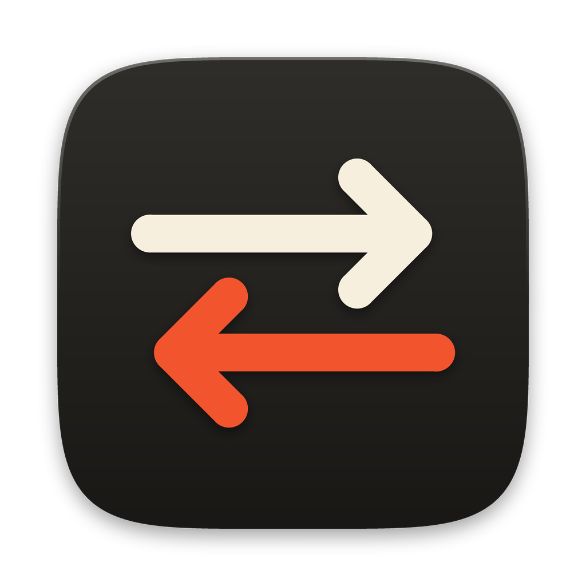

<div align="center">
  
  <h1>Shift</h1>
  <p><b>Native macOS replacement for Android File Transfer in pure SwiftUI</b></p>

  [](https://github.com/chrollovale/Shift/releases/latest)
  [](https://github.com/chrollovale/Shift)
  [](https://swift.org)
  [](./LICENSE)

  <br />
  <a href="https://github.com/chrollovale/Shift/releases/latest"><b>📥 Download Shift for macOS (.zip)</b></a>
</div>

---

A native macOS app for moving files between an Android phone and your Mac, in both directions. It's a modern, reliable replacement for Google's Android File Transfer, which is no longer supported.

Retro Platinum look (cream paper, black ink, keycap buttons, pixel type), written in SwiftUI. Zero third-party dependencies.

---

## 🚀 Quick Install

1. Download **[Shift-v1.0.0-macos.zip](https://github.com/chrollovale/Shift/releases/latest)**.
2. Unzip and drag `Shift.app` into your `/Applications` folder.
3. Connect your Android phone with **USB debugging** enabled.

---

## 🛠️ Build From Source

You need a Mac running macOS 13 or newer, plus Apple's developer tools:

```bash
xcode-select --install        # once, if you don't have Xcode or the Command Line Tools
git clone https://github.com/chrollovale/Shift.git
cd Shift
./build.sh --run              # builds build/Shift.app and opens it
```

Other options: `./build.sh --install` copies the app to `/Applications`. `UNIVERSAL=1 ./build.sh` builds for both Apple Silicon and Intel (needs full Xcode).

The app is signed ad-hoc and built on your own Mac, so Gatekeeper won't complain.

---

## First launch

1. **Platform Tools.** Shift moves files with `adb`, Google's Android bridge. If it isn't on your Mac, click **Download Tools** (about 12 MB, one time). If you already have adb from Homebrew or Android Studio, Shift finds it by itself.
2. **Phone setup, once.** On the phone, open Settings › About phone and tap *Build number* 7 times. Then open Settings › System › Developer options and turn on **USB debugging**. Plug in the cable and tap **Allow** on the phone.
3. That's it. Your phone's storage is on the left, your Mac on the right.

Shift can't use the "File transfer (MTP)" USB mode the old Android File Transfer relied on. macOS has no built-in MTP support, and building one safely needs a physical device to test against. adb works on every Android phone and also gives you wireless transfer.

---

## Using it

- Pick files in either pane. Click, ⌘-click to add, ⇧-click for a range.
- Press **TO MAC** or **TO PHONE** in the middle. Files go to the folder currently open on the other side.
- Or drag: between the two panes, from a Finder window onto the phone pane, or from the phone pane onto a Finder window.
- Double-click a folder to open it. Double-click a Mac file to open it. Right-click for rename, delete, reveal in Finder.
- The quick-access chips above each list jump to DCIM, Download, Documents and the like. An SD card gets its own chip.
- Transfers queue up at the bottom with live progress, speed and a cancel button. If a name already exists you choose between replacing and skipping.
- **Wi-Fi:** the device menu in the title bar has *Connect over Wi-Fi…* for Android 11 and newer (Developer options › Wireless debugging).

| Shortcut | Action |
| --- | --- |
| ⌘→ | Send selection to Mac |
| ⌘← | Send selection to phone |
| ⌘R | Refresh |
| ⇧⌘N | New folder on phone |
| ⌥⇧⌘N | New folder on Mac |
| ⇧⌘. | Show hidden files |

Files you copy to the phone's photo folders are announced to Android's media scanner so they appear in Gallery.

---

## Troubleshooting

- **Phone never shows up:** check that USB debugging is on, try another cable (some are charge-only), and unlock the phone. Revoke old authorisations in Developer options if the Allow prompt doesn't appear.
- **"Android doesn't allow access to this location":** Android 11+ blocks `Android/data` and `Android/obb` from adb. That's a system rule, not a Shift bug.
- **macOS asks for access to Downloads, Documents and so on:** allow it. Shift only reads folders you open in it. If you declined earlier, change it in System Settings › Privacy & Security › Files and Folders.
- **Use a different adb:** choose *Use my own adb…* on the setup screen.

---

## Project layout

```
Package.swift
build.sh                      builds and assembles Shift.app
Resources/                    Info.plist, AppIcon.icns, Silkscreen pixel font
Tools/make_icon.py            regenerates the icon (needs Pillow)
Sources/Shift/
  ShiftApp.swift              app entry, window, menu commands
  Core/                       adb wrapper, output parsing, local file helpers
  App/                        AppModel (all state and actions), shared types
  UI/                         theme, panes, transfer tray, setup screens, dialogs
```

The pixel font is Silkscreen (SIL Open Font License, included in `Resources/Fonts`).

---

### ⭐ Support the Project
If Shift made moving files between your Android phone and Mac easier, please give this repository a **Star** — it helps more people find it!
